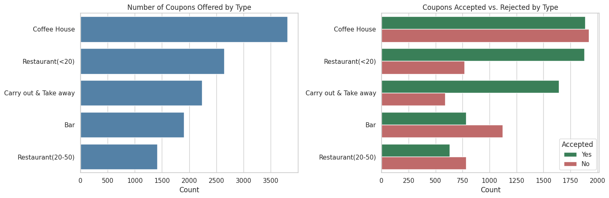
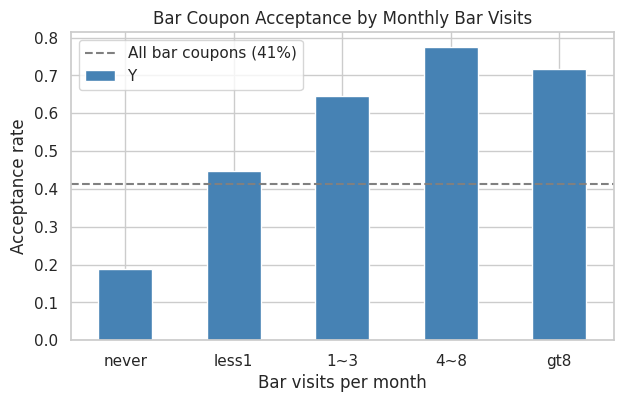
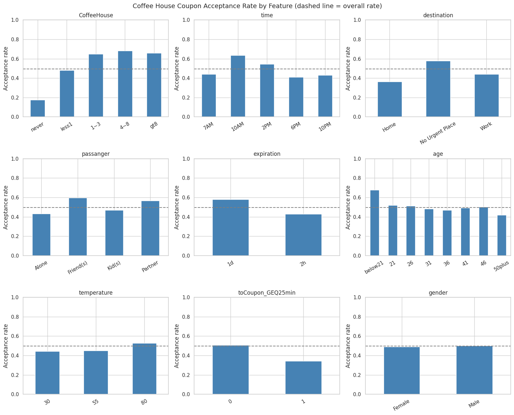
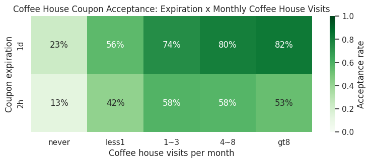

# Will the Customer Accept the Coupon?

**UC Berkeley Professional Certificate in Machine Learning and Artificial Intelligence — Practical Application Assignment 5.1**

The complete analysis is contained in the Jupyter notebook [`prompt.ipynb`](prompt.ipynb).

## Business Question

A mobile application delivers coupons to drivers for nearby businesses. Proximity determines whether a coupon is delivered, but it does not determine whether the driver will act on it. The objective of this analysis is to identify the characteristics that distinguish drivers who accept a coupon from those who do not, so that coupons can be directed toward the drivers and situations in which they are most likely to be used.

## Data

The dataset originates from the UCI Machine Learning Repository and was collected through a survey on Amazon Mechanical Turk. Each of the 12,684 records describes a driving scenario (destination, passengers, weather, temperature, and time of day), the coupon offered (one of five venue types, with an expiration of two hours or one day), and the respondent's demographic profile and habitual visit frequency for each venue type. The target variable `Y` equals 1 when the respondent would use the coupon, either immediately or before it expired, and 0 otherwise.

### Data Preparation

The following decisions were made before any analysis was performed:

- **`car` column removed.** Approximately 99% of its values are missing, and the column cannot support any meaningful conclusion.
- **Duplicate rows removed.** Seventy-four records were exact duplicates and were removed so that no response is counted twice.
- **Rows with a missing visit frequency removed.** The five frequency columns (`Bar`, `CoffeeHouse`, `CarryAway`, `RestaurantLessThan20`, `Restaurant20To50`) contained a small number of gaps. Because these columns are central to the analysis, imputing a value would have introduced fabricated behavior; the affected rows (approximately 5% of the data) were dropped instead.

The cleaned dataset contains 12,007 complete observations. The column `toCoupon_GEQ5min` was also noted to be constant (every value equals 1) and therefore carries no information.

## Overall Acceptance

Across all coupon types, 56.8% of coupons were accepted. Acceptance varies considerably by venue type: inexpensive offerings such as Carry Out & Take Away (73.6%) and restaurants under \$20 (71.0%) are accepted far more often than Coffee House (49.6%), restaurants from \$20 to \$50 (44.7%), and Bar (41.2%) coupons.



## Bar Coupons

Bar coupons were accepted 41.2% of the time. The guided comparisons produced the following results:

| Group | Acceptance Rate | All Others |
|---|---|---|
| Visits a bar more than 3 times per month | 76.2% | 37.2% |
| Visits a bar more than once per month and is over 25 | 69.0% | 33.7% |
| Visits a bar more than once per month, no child passengers, not in farming, fishing, or forestry | 70.9% | 29.7% |
| Visits a bar more than once per month and is under 30 | 72.0% | 34.8% |
| Visits inexpensive restaurants 4+ times per month and earns under \$50K | 45.6% | 40.2% |



**Conclusion.** The strongest predictor of bar coupon acceptance is an existing bar habit. Drivers who visit a bar at least once a month accept at roughly twice the rate of those who rarely or never go, and acceptance among drivers who never visit bars is very low. The absence of children in the vehicle and the driver being a younger adult further support acceptance, whereas income and inexpensive-restaurant habits add little. The bar coupon appears to reward existing bar-goers rather than create new ones.

## Independent Investigation: Coffee House Coupons

Coffee House coupons were selected for further investigation because they are the most frequently offered coupon type (3,809 offers) and are accepted almost exactly half of the time (49.6%), which makes the accepting customer the most valuable to identify.



The principal findings are as follows:

- **Visit frequency** is the dominant factor. Drivers who never visit coffee houses accepted 18% of these coupons, while drivers who visit at least once a month accepted between 65% and 68%.
- **Time of day** matters. Acceptance peaks at 10AM (63%) and declines to between 41% and 44% at 7AM, 6PM, and 10PM.
- **Destination** is closely related. Drivers with no urgent destination accepted 58%, compared with 44% when driving to work and 36% when driving home.
- **Passengers** increase receptiveness. Drivers accompanied by friends (60%) or a partner (57%) accepted more often than those driving alone (43%).
- **Expiration** influences use. One-day coupons were accepted 58% of the time, compared with 43% for two-hour coupons.
- **Distance** reduces acceptance. When the venue is 25 or more minutes away, acceptance falls to 34%.
- **Gender** shows no meaningful difference.



Combining the strongest factors isolates highly receptive segments:

| Segment | Acceptance Rate | Count |
|---|---|---|
| Visits a coffee house 1+ times per month | 65.9% | 1,864 |
| ... and coupon delivered at 10AM or 2PM | 77.2% | 784 |
| ... with no urgent destination and accompanied by passengers | 75.2% | 787 |
| ... with a one-day coupon and no urgent destination | 80.2% | 465 |
| Visits a coffee house less than once per month or never | 33.9% | 1,945 |

## Key Findings

1. **Coupons reinforce existing habits rather than create new ones.** Past visit frequency for the venue type is the strongest single predictor of acceptance for both Bar and Coffee House coupons.
2. **Context determines whether the habit can be acted upon.** Child passengers suppress bar coupon acceptance; time of day, destination, and expiration window shape Coffee House acceptance.
3. **Demographics contribute comparatively little.** Gender and income have a limited effect once visit frequency and driving context are taken into account.

## Recommendations

1. Direct coupons primarily toward drivers with a demonstrated history of visiting the venue type.
2. For coffee houses, deliver coupons mid-morning or early afternoon to drivers with no urgent destination, and prefer a one-day expiration over two hours.
3. For bars, do not deliver coupons when children are passengers, and concentrate on regular bar-goers over the age of 21.
4. Avoid spending coupon inventory on drivers who never visit the venue type, as their acceptance rates are consistently low.

## Next Steps

The findings above are descriptive and are based on survey responses about hypothetical scenarios rather than observed redemptions. A natural extension would be to fit a classification model (for example, logistic regression or a decision tree) to quantify the relative importance of each factor while controlling for the others, and to validate the recommended targeting rules against actual redemption data.

## Repository Structure

```
module5/
├── README.md          Summary of findings (this file)
├── prompt.ipynb       Full analysis notebook
├── data/
│   └── coupons.csv    Source data
├── figures/           Charts referenced in this README
└── images/            Images supplied with the assignment
```

## Tools

Python, pandas, NumPy, Matplotlib, and seaborn.
